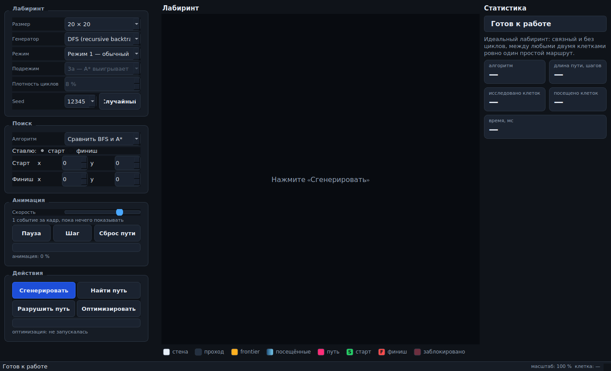
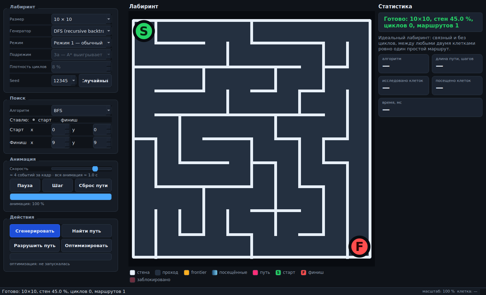
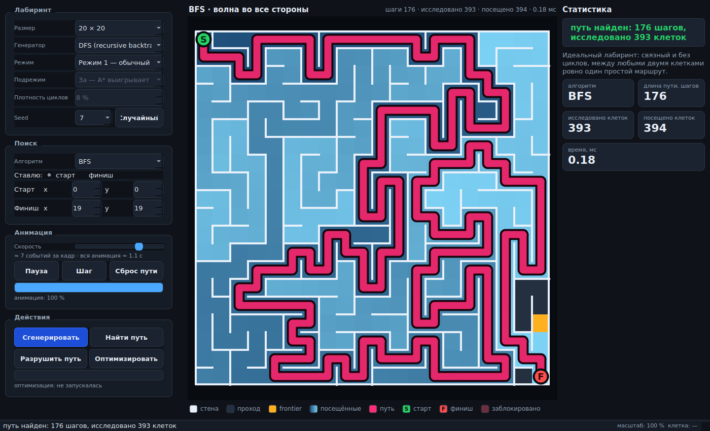
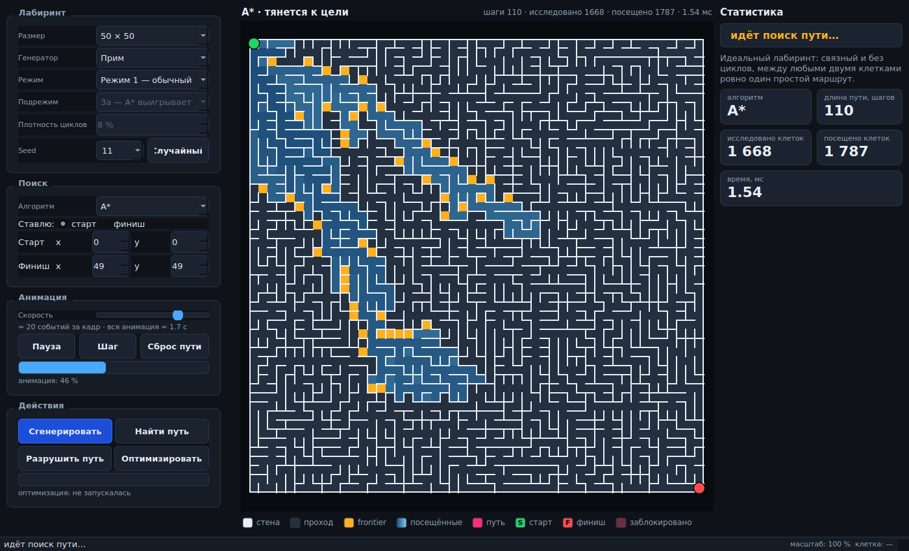
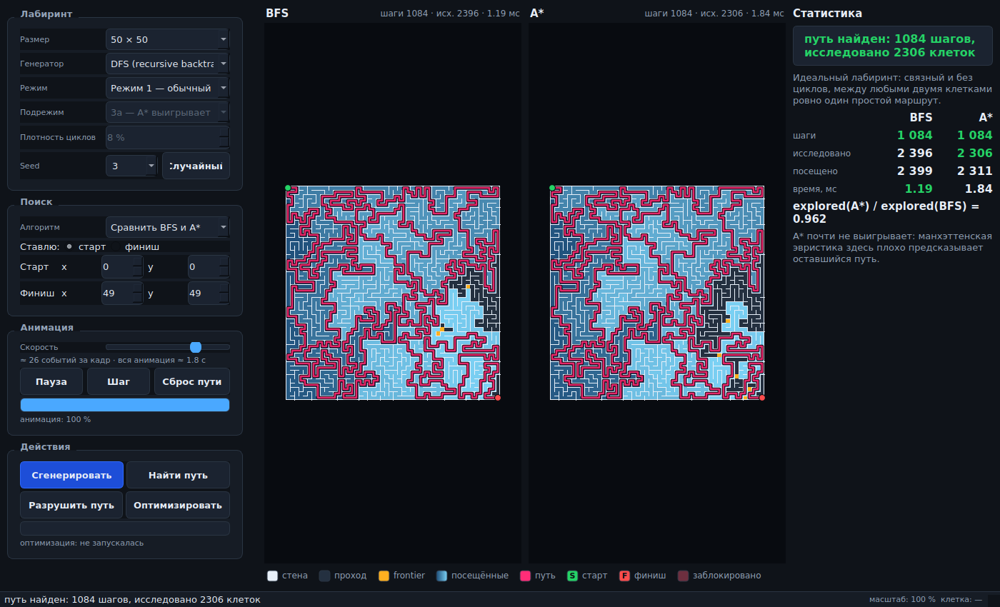
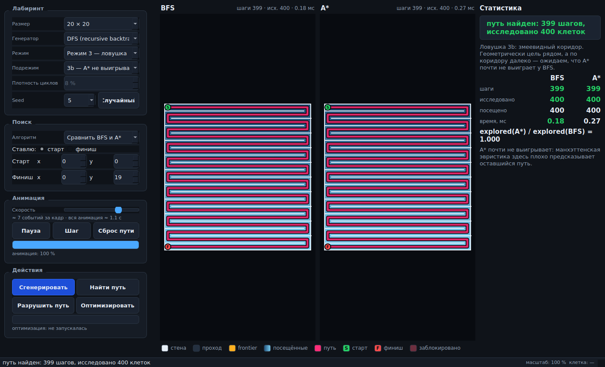
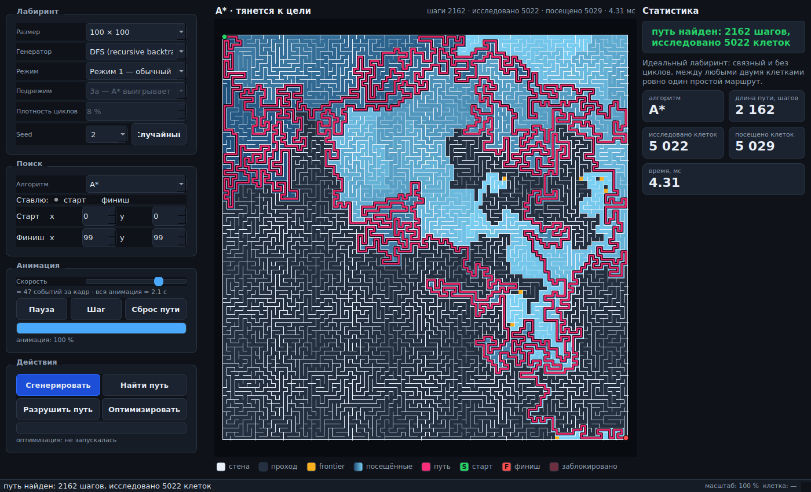
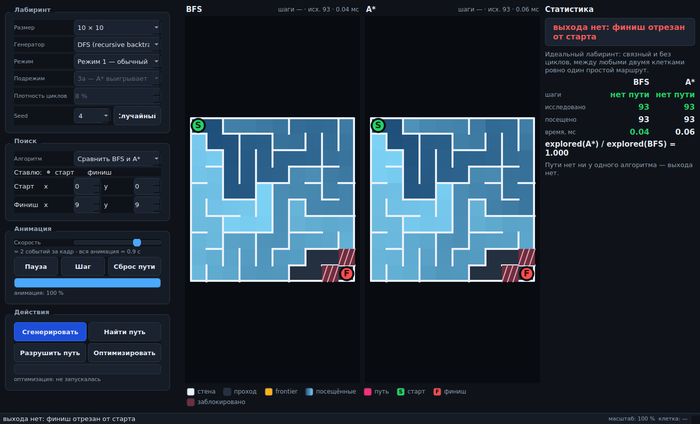

# Лабораторная работа №5. Генератор случайных лабиринтов и поиск оптимального пути

Программа генерирует случайный лабиринт, гарантирует существование пути от
входа до выхода и пошагово показывает, как BFS и A* этот путь ищут.

Логика (модель, генераторы, поиск, режимы, замеры, генетический поиск) — только
стандартная библиотека Python 3.10+, лежит в пакете `maze/` и **не импортирует
ни Qt, ни что-либо ещё внешнее**: её можно гонять из консоли и тестировать без
экрана. Графический интерфейс — PyQt6 (единственная внешняя зависимость):
`pip install -r requirements.txt`.

| требование задания | где реализовано |
|---|---|
| три генератора идеального лабиринта, шаги видны | `maze/generators.py` |
| BFS и A* с манхэттенской эвристикой | `maze/solvers.py` |
| четыре метрики: шаги, исследовано, посещено, время | `maze/solvers.py`, `maze/metrics.py` |
| режимы 1, 2 и 3 (оба подрежима ловушки) | `maze/modes.py` |
| GUI на PyQt6 с пошаговой анимацией | `mazegui/`, запуск `gui.py` |
| CLI для защиты | `cli.py` |
| 117 тестов unittest | `tests/` |
| усложнение 1: поиск лабиринта, трудного для A* | `maze/hunt.py`, `cli.py hunt` |
| усложнение 2: кнопка «Разрушить путь» | `maze/modes.break_path`, `gui.py` |

## 1. Установка и запуск

Единственная зависимость — PyQt6 (нужна только для окна; логика и CLI
работают без неё):

```bash
python3 -m pip install -r requirements.txt   # PyQt6>=6.5,<7
python3 --version                            # 3.10 или новее

python3 gui.py                               # окно
python3 -m unittest discover tests           # 117 тестов
```

Тесты GUI работают без дисплея (Qt в режиме `offscreen`), поэтому на сервере
достаточно:

```bash
QT_QPA_PLATFORM=offscreen python3 -m unittest discover tests
QT_QPA_PLATFORM=offscreen python3 -m mazegui.shots      # переснять скриншоты
```

CLI (то, что удобно набирать на защите):

```bash
# пример из задания
python cli.py run --size 50 --start 0,0 --end 49,49 --seed 12345 \
    --algo astar --generator dfs --mode 1

# ловушка: сравнить BFS и A* на змеевидном коридоре
python cli.py run --size 20 --seed 7 --mode 3 --trap b --algo both --ascii

# таблица BFS vs A* по всем размерам и режимам
python cli.py bench --sizes 10,20,50,100 --seed 12345

# поиск лабиринта, максимально трудного для A*
python cli.py hunt --size 20 --seed 1 --population 16 --generations 20

# то же состояние, что и в CLI, но в окне
python cli.py run --size 10 --seed 5 --mode 2 --gui
```

Флаги `run`: `--size {10,20,50,100}`, `--seed`, `--generator {dfs,prim,kruskal}`,
`--mode {1,2,3}`, `--trap {a,b}` (только для режима 3), `--cycles` (плотность
циклов, по умолчанию 0.08), `--start x,y`, `--end x,y`,
`--algo {bfs,astar,both}`, `--repeats` (сколько раз мерить время),
`--no-time`, `--ascii` / `--no-ascii`, `--gui`.

## 2. Структура проекта

```
maze/                    логика: без Qt, только стандартная библиотека
  grid.py                модель: стены между клетками, старт/финиш, копирование
  events.py              события visit / carve / frontier / expand
  generators.py          Randomized DFS (итеративный), Прим, Краскал с DSU
  solvers.py             BFS и A*, вспомогательные обходы
  modes.py               режимы 1/2/3, лабиринт-ловушка, «разрушить путь»
  metrics.py             честный замер времени, сравнение, статистика
  hunt.py                генетический поиск лабиринта, трудного для A*
mazegui/                 интерфейс на PyQt6
  theme.py               палитра, шрифты, QSS
  canvas.py              QWidget с paintEvent, слоями QImage/QPixmap, зумом
  legend.py              легенда цветов (всегда на экране)
  panels.py              заголовки холстов, бейдж состояния, плитки, таблица
  workers.py             QThread-воркеры поиска и оптимизации
  app.py                 главное окно, управление, таймер анимации
  shots.py               сценарии скриншотов + замер FPS
gui.py                   тонкая точка входа: python gui.py
cli.py                   консольный запуск: run / bench / hunt
experiments.py           скрипт, которым получены таблицы §10–§11
requirements.txt         PyQt6
docs/screenshots/        скриншоты интерфейса (см. §8)
tests/                   117 тестов: логика, CLI, GUI в offscreen-режиме
```

Архитектурное решение, на котором держится вся пошаговая визуализация:
генераторы и решатели — это **функции-генераторы Python**, которые меняют
лабиринт и на каждом шаге отдают событие (`visit`, `carve`, `frontier`,
`expand`). GUI перебирает события и красит клетки, CLI и тесты прогоняют тот
же поток до конца. Логика и отрисовка не дублируются и не могут разойтись.

## 3. Модель лабиринта (`maze/grid.py`)

Лабиринт — сетка `width × height` клеток, стена хранится **между** клетками:
на каждую клетку битовая маска четырёх стен. Снятие стены между A и B снимает
её с обеих сторон, поэтому состояние всегда согласовано.

* Порядок обхода соседей фиксирован (север, восток, юг, запад) — от него
  зависит порядок обхода в алгоритмах, а значит и полная воспроизводимость.
* `Maze.copy()` даёт независимую копию (нужно для генетического поиска).
* `blocked` — замурованные клетки (для «разрушить путь» и для случая «выхода
  нет»): они непроходимы, но не меняют граф стен.
* `cycles = E − V + 1`, `is_perfect` = «связный и без циклов», `wall_density`,
  `reachable()`, `to_ascii()`.
* Внешняя рамка никогда не пробивается, поэтому лабиринт всегда замкнут.

## 4. Генераторы (`maze/generators.py`)

Все три реализованы самостоятельно и дают **идеальный лабиринт**: связный,
без циклов, ровно `N − 1` пробитая стена для `N` клеток. Это проверяется тестом
на связность и на число рёбер, а также на то, что между любыми двумя клетками
ровно один простой маршрут.

* **Randomized DFS (recursive backtracking)** — итеративный, со стеком вместо
  рекурсии: 100×100 не упирается в лимит рекурсии и в размер стека вызовов.
  Даёт длинные извилистые коридоры и мало развилок.
* **Алгоритм Прима** — рандомизированный, через список фронтовых стен
  (выбранная стена удаляется swap-pop за O(1)). Даёт много коротких тупиков
  и развилок во все стороны.
* **Алгоритм Краскала** — рёбра сетки перемешиваются, DSU с рангом и сжатием
  путей решает, пробивать ли стену. Равномерно «случайное» остовное дерево.

Детерминизм: используется только `random.Random(seed)` (глобальный `random`
не трогается — это отдельный тест), а все переборы идут по спискам в
фиксированном порядке.

## 5. Поиск пути (`maze/solvers.py`)

* **BFS** — очередь `deque`, волна во все стороны, кратчайший путь в
  невзвешенном лабиринте гарантирован.
* **A*** — `heapq` с ключом `(f, h, счётчик вставки, клетка)`. Манхэттенская
  эвристика на 4-связной сетке допустима и состоятельна (один шаг меняет
  расстояние не больше чем на 1), поэтому путь оптимален.

Оба возвращают одинаковый результат: путь, число шагов (длина в рёбрах),
`explored` — сколько клеток извлечено из очереди/кучи и раскрыто,
`visited` — сколько клеток достигнуто **вместе с frontier**, время и список
событий для анимации.

Три важные детали:

1. **Время меряется отдельным прогоном без записи событий** (`metrics.bench_time`,
   лучшее из 5 повторов, `time.perf_counter`). Иначе запись событий исказит
   сравнение: на маленьких лабиринтах она дороже самого поиска.
2. **Тай-брейк A*** — при равном `f` раскрывается клетка с меньшим `h`, то
   есть ближе к цели; последний ключ — счётчик вставки, так что результат
   детерминирован. На открытых пространствах это и даёт выигрыш A* (см. §11).
3. **Нет пути — нет исключения**: `path is None`, `steps is None`,
   `explored` показывает, сколько успели посмотреть.

Вспомогательные обходы: `distance_map`, `shortest_path_cells` (клетки, лежащие
хотя бы на одном кратчайшем маршруте), `count_shortest_paths` (динамика по
слоям BFS — сколько всего кратчайших маршрутов). Последние два нужны режиму 2
и статистике.

## 6. Три режима (`maze/modes.py`)

**Режим 1 — обычный идеальный лабиринт.** Выбранный генератор, гарантированное
единственное решение. `cycles = 0`, кратчайших маршрутов ровно 1.

**Режим 2 — несколько путей.** Сначала строится идеальный лабиринт, затем
снимается случайная доля **оставшихся** стен (`--cycles`, по умолчанию 8 %).
Каркас — дерево, поэтому любая оставшаяся внутренняя стена гарантированно
создаёт ровно один цикл: «удаляем только те стены, что действительно создают
цикл». Число циклов (`E − V + 1`) и число кратчайших маршрутов считаются и
показываются; в режиме 2 маршрутов заведомо больше одного (см. таблицу ниже:
при 10 % — 972 маршрута в среднем на 50×50). В GUI в режиме 2 вдобавок
подсвечиваются светло-зелёным все клетки, лежащие хотя бы на одном
кратчайшем маршруте, — видно, что маршрутов несколько.

**Режим 3 — лабиринт-ловушка.** Строится под выбранную цель (старт/финиш).

* **3a «A\* выигрывает».** Идеальный каркас (он гарантирует связность), из
  которого снимаются почти все стены: остаётся ~1.5 % внутренних стен —
  открытая арена. Путь почти совпадает с манхэттенским, эвристика точна, и A*
  идёт почти по прямой, а BFS заливает ромб во все стороны. Постройка целевая:
  программа сама меряет `explored(A*)/explored(BFS)` и, если отношение больше
  0.28, снимает стены рядом с найденным маршрутом (именно они заставляли A*
  отклоняться), а в крайнем случае открывает арену полностью.
* **3b «A\* почти не выигрывает».** Змеевидный коридор шириной в одну клетку,
  проходящий через все клетки сетки. Геометрически цель рядом, а по коридору —
  далеко: путь 9999 шагов при манхэттенском расстоянии 198 на 100×100
  (извилистость ×50). Почти все клетки имеют `f ≤ f*`, поэтому A* раскрывает
  практически столько же клеток, сколько BFS.

После постройки режим 3 автоматически прогоняет оба алгоритма и печатает
отношение — в CLI в разделе «Лабиринт», в GUI в строке состояния, и сразу
открывает сравнение двух панелей.

| ловушка | размер | путь, шагов | манхэттен | извилистость | BFS исследовал | A* исследовал | A*/BFS |
|---|---|---|---|---|---|---|---|
| 3a | 10×10 | 18 | 18 | 1.0 | 100 | 19 | **0.190** |
| 3a | 20×20 | 38 | 38 | 1.0 | 400 | 39 | **0.097** |
| 3a | 50×50 | 98 | 98 | 1.0 | 2500 | 112 | **0.045** |
| 3a | 100×100 | 198 | 198 | 1.0 | 10000 | 257 | **0.026** |
| 3b | 10×10 | 99 | 18 | 5.5 | 100 | 100 | **1.000** |
| 3b | 20×20 | 399 | 38 | 10.5 | 400 | 400 | **1.000** |
| 3b | 50×50 | 2499 | 98 | 25.5 | 2500 | 2500 | **1.000** |
| 3b | 100×100 | 9999 | 198 | 50.5 | 10000 | 10000 | **1.000** |

Тесты фиксируют эти свойства для всех четырёх размеров: 3a `≤ 0.3`,
3b `≥ 0.8` (фактически ровно 1.0).

## 7. GUI на PyQt6 (`mazegui/`, запуск `gui.py`)

Окно по умолчанию **1400×850**, изменяемое, минимум 1080×700. Лабиринт
занимает всё свободное место и масштабируется вместе с окном, клетки всегда
квадратные: сторона = `min(ширина/столбцы, высота/строки)`.

Компоновка:

* **слева** — параметры: «Лабиринт» (размер 10/20/50/100, генератор DFS/Прим/
  Краскал, режим 1/2/3, подрежим ловушки a/b, плотность циклов, seed + кнопка
  «Случайный»), «Поиск» (BFS / A* / сравнить, переключатель «Ставлю:
  старт/финиш», поля координат), «Анимация» (ползунок скорости, «Пауза»,
  «Шаг», «Сброс пути», прогресс с процентом), «Действия» («Сгенерировать»,
  «Найти путь», «Разрушить путь», «Оптимизировать»);
* **в центре** — холст (в режиме сравнения два холста рядом, у каждого свой
  заголовок и свои счётчики), под ним **легенда цветов, которая видна всегда**;
* **справа** — статистика крупными числами: бейдж состояния, плитки
  «алгоритм / длина пути / исследовано / посещено / время», а в режиме
  сравнения — таблица BFS vs A* с зелёной подсветкой лучшего результата и
  строка `explored(A*) / explored(BFS)` с коротким выводом;
* **внизу** — строка состояния: что происходит, координаты клетки под курсором
  и текущий масштаб.

Мышь: клик — поставить старт или финиш (что выбрано в «Ставлю»), правая
кнопка — противоположное, колесо — масштаб до 8×, средняя кнопка —
перетаскивание, двойной клик — сброс масштаба. У каждого элемента управления
есть подсказка; ошибки и ход работы видны в бейдже и строке состояния, модальных
диалогов нет (окно не «залипает»).

Цвета подобраны так, чтобы состояние читалось и при дальтонизме (различаются
не только оттенком, но яркостью и формой):

* фон окна почти чёрный, пол клетки — тёмно-синий, **стены — светлые линии**
  (`#e8f0f9`, толщина `0.11 × клетка`, минимум 1 px), на стыках закрашиваются
  узлы, поэтому углы без щелей, а за концы стен ничего не торчит;
* **frontier** — оранжевый, **посещённые** — синий градиент по порядку
  раскрытия (раньше — темнее `#1d4d78`, позже — светлее `#7cd2f5`): видно, как
  BFS расходится волной, а A* тянется к цели;
* **путь** — толстая полупрозрачная малиновая линия с тёмной обводкой поверх
  клеток (на длинных путях она становится тоньше, чтобы не закрывать лабиринт);
* **старт** — зелёный круг с буквой `S`, **финиш** — красный круг с буквой `F`
  (буквы на 10×10 и 20×20; на 50×50 и 100×100 — просто крупные маркеры);
* **заблокированные** клетки — красно-серая диагональная штриховка.

### 7.1 Почему QWidget с `paintEvent`, а не 10 000 объектов сцены

На 100×100 сцена из `QGraphicsRectItem` на клетку означает 10 000 объектов,
20 000 линий стен и пересчёт индекса при каждом изменении цвета — на кадр это
десятки миллисекунд и гарантированные подёргивания. Поэтому холст — свой
`QWidget` с тремя слоями:

1. **слой клеток** — `QImage` ровно `width × height` пикселей (один пиксель на
   клетку). Раскраска клетки — один `setPixelColor`, то есть O(1) и без
   пересоздания чего-либо; на экран слой попадает одним `drawImage` с
   масштабированием без сглаживания, и каждый пиксель становится ровным
   квадратом.
2. **слой стен** — `QPixmap` в экранном разрешении: рисуется один раз после
   генерации (и при смене размера/масштаба) одной пачкой `drawLines`. Пока идёт
   анимация генерации, пробитая стена стирается в этом же слое «ластиком»
   (`CompositionMode_Clear`) — O(1) на событие, без пересборки.
3. **верхний слой** — путь, маркеры, штриховка замурованных клеток и подсветка
   клетки под курсором; всё рисуется в `paintEvent` поверх первых двух.

Итого на кадр: одно масштабирование картинки и один `drawPixmap` независимо от
размера лабиринта. Замер в offscreen-режиме (`python -m mazegui.shots --fps`)
на этой машине: **100×100 — 0.26–0.72 мс на кадр** при таймере 20 мс, то есть
запас 30–70×; реальные 50 FPS упираются в таймер, а не в отрисовку (§10.4).

### 7.2 Анимация и фоновые вычисления

* Анимация — `QTimer` с шагом 20 мс; за тик обрабатывается пачка событий, её
  размер задаёт ползунок: от «1 событие за кадр» до «весь процесс примерно за
  секунду» (формула `(всего событий / 30)^(ползунок/100)`, в подписи показано
  и число событий на кадр, и ожидаемая длительность).
* «Пауза» останавливает таймер, «Шаг» продвигает ровно одну пачку, «Сброс
  пути» убирает раскраску, оставляя лабиринт. Смена размера, генератора, режима
  или seed во время анимации корректно её останавливает.
* Поиск (несколько прогонов ради честного замера времени) и генетическая
  оптимизация выполняются в `QThread`-воркерах (`SearchWorker`, `HuntWorker`) и
  возвращаются сигналами: окно не блокируется, кнопки на время расчёта
  отключаются. Генерация потока не требует — она и так идёт по шагам.

### 7.3 Проверка без дисплея

На этой машине нет X-сервера, поэтому окно проверяется в offscreen-режиме:
тесты создают настоящее окно, нажимают кнопки, доводят анимацию до конца,
кликают по холсту и сравнивают состояние — `tests/test_gui_qt.py` (31 тест),
плюс скриншоты и FPS (`tests/test_gui_screenshots.py`). Для работы PyQt6 в
контейнере пришлось доставить системную библиотеку `libEGL.so.1` (на обычной
машине она есть из коробки); в README это отмечено как особенность окружения.

## 8. Скриншоты

Все кадры сняты в offscreen-режиме самим приложением
(`QT_QPA_PLATFORM=offscreen python -m mazegui.shots`) в окне 1400×850 и лежат в
`docs/screenshots/`.

**Пустое окно** — видно, из чего состоит интерфейс: параметры, холст, легенда,
статистика, строка состояния.



**10×10 после генерации** — крупные клетки, стены светлыми линиями, `S` и `F`
с буквами, все метрики пока пустые.



**20×20, путь найден BFS** — итоговый путь малиновой линией, голубым градиентом
раскрытые клетки (раньше — темнее), оранжевым frontier, справа крупные числа:
176 шагов, 393 исследовано, 0.24 мс.



**50×50, середина анимации A\*** — виден «луч» A*: узкая полоса раскрытых
клеток и фронт из оранжевых клеток, 46 % анимации.



**Режим «сравнить», 50×50** — два холста рядом, у каждого свои счётчики, справа
таблица BFS vs A* с подсветкой лучшего результата и отношение
`explored(A*)/explored(BFS)`.



**Режим 3b (ловушка со змеем), 20×20** — коридор проходит через все клетки,
поэтому путь 399 шагов, оба алгоритма раскрывают все 400 клеток, отношение
1.000: A* не получает преимущества.



**100×100 с путём** — 10 000 клеток, стены тонкие, но структура читается; путь
2162 шага, исследовано 5022 клетки, 4.24 мс.



**«Выхода нет»** — финиш отрезан: замурованные клетки заштрихованы, оба
алгоритма честно сообщают «нет пути», отношение 1.000.



## 9. Как проходить защиту

1. `python -m unittest discover tests` — 105 тестов, все зелёные.
2. `python cli.py run --size 50 --start 0,0 --end 49,49 --seed 12345 --algo astar --generator dfs --mode 1`
   — параметры, длина пути, исследовано, посещено, время.
3. `python cli.py run --size 20 --seed 7 --mode 3 --trap b --algo both --ascii`
   — видно, что A* не получает преимущества: отношение 1.000.
4. `python cli.py run --size 20 --seed 7 --mode 3 --trap a --algo both`
   — видно обратное: отношение ~0.1.
5. Повторить ту же команду — вывод побайтово тот же (кроме строк времени;
   с `--no-time` совпадает полностью).
6. `python cli.py run ... --gui` или `python gui.py` — показать пошаговую
   генерацию и поиск, сравнение двух панелей, «Разрушить путь».
7. Любые свои параметры: размер, старт, финиш, seed, алгоритм — всё
   принимается аргументами или в окне.

## 10. Измерения

Условия: 4 vCPU, Python 3.12, время — лучшее из 5 прогонов без записи событий.
Все таблицы ниже получены скриптом `experiments.py` на этом коде; числа —
средние по нескольким seed'ам (колонка «seed'ов» или подпись к таблице).

### 10.1 BFS vs A* по режимам и размерам

| режим | размер | путь, шагов | BFS исследовал | A* исследовал | A*/BFS | BFS, мс | A*, мс | seed'ов |
|---|---|---|---|---|---|---|---|---|
| 1 | 10×10 | 53.3 | 74 | 65 | 0.902 | 0.04 | 0.06 | 3 |
| 1 | 20×20 | 171.3 | 281 | 248 | 0.883 | 0.16 | 0.22 | 3 |
| 1 | 50×50 | 633.3 | 1285 | 1093 | 0.861 | 0.79 | 1.08 | 3 |
| 1 | 100×100 | 2565.3 | 5874 | 5667 | 0.962 | 3.04 | 4.80 | 3 |
| 2 | 10×10 | 24.0 | 70 | 38 | 0.553 | 0.03 | 0.03 | 3 |
| 2 | 20×20 | 58.7 | 369 | 262 | 0.711 | 0.17 | 0.20 | 3 |
| 2 | 50×50 | 170.0 | 2485 | 2338 | 0.941 | 1.24 | 2.09 | 3 |
| 2 | 100×100 | 277.3 | 9943 | 7208 | 0.725 | 5.18 | 7.42 | 3 |
| 3a | 10×10 | 18.0 | 100 | 19 | 0.190 | 0.05 | 0.02 | 3 |
| 3a | 20×20 | 38.0 | 400 | 39 | 0.097 | 0.21 | 0.04 | 3 |
| 3a | 50×50 | 98.0 | 2500 | 112 | 0.045 | 1.40 | 0.12 | 3 |
| 3a | 100×100 | 198.0 | 10000 | 257 | 0.026 | 5.75 | 0.30 | 3 |
| 3b | 10×10 | 99.0 | 100 | 100 | 1.000 | 0.04 | 0.06 | 3 |
| 3b | 20×20 | 399.0 | 400 | 400 | 1.000 | 0.18 | 0.27 | 3 |
| 3b | 50×50 | 2499.0 | 2500 | 2500 | 1.000 | 1.21 | 1.76 | 3 |
| 3b | 100×100 | 9999.0 | 10000 | 10000 | 1.000 | 4.97 | 7.56 | 3 |

Читается так: в режиме 1 (идеальный лабиринт) A* выигрывает мало — путь
длинный и извилистый, и эвристика почти не помогает далеко от цели (на 100×100
вообще 0.96). В режиме 2 с ростом числа циклов путь укорачивается, эвристика
становится точнее, и преимущество A* растёт. В 3a отношение падает до 0.03, в
3b остаётся 1.00 — это и есть «ловушка».

### 10.2 CLI: все размеры и все генераторы

| размер | генератор | алгоритм | шагов | исследовано | посещено | время, мс |
|---|---|---|---|---|---|---|
| 10×10 | dfs | BFS | 62 | 100 | 100 | 0.044 |
|  |  | A* | 62 | 82 | 86 | 0.057 |
| 10×10 | prim | BFS | 18 | 100 | 100 | 0.043 |
|  |  | A* | 18 | 38 | 49 | 0.029 |
| 10×10 | kruskal | BFS | 20 | 77 | 82 | 0.034 |
|  |  | A* | 20 | 35 | 45 | 0.027 |
| 20×20 | dfs | BFS | 198 | 366 | 369 | 0.170 |
|  |  | A* | 198 | 318 | 324 | 0.228 |
| 20×20 | prim | BFS | 42 | 398 | 398 | 0.181 |
|  |  | A* | 42 | 268 | 304 | 0.216 |
| 20×20 | kruskal | BFS | 54 | 372 | 376 | 0.173 |
|  |  | A* | 54 | 233 | 255 | 0.181 |
| 50×50 | dfs | BFS | 624 | 1107 | 1110 | 0.543 |
|  |  | A* | 624 | 1057 | 1060 | 0.843 |
| 50×50 | prim | BFS | 102 | 2500 | 2500 | 1.243 |
|  |  | A* | 102 | 990 | 1107 | 0.909 |
| 50×50 | kruskal | BFS | 142 | 2192 | 2209 | 1.077 |
|  |  | A* | 142 | 1231 | 1279 | 1.121 |
| 100×100 | dfs | BFS | 3294 | 7465 | 7466 | 3.883 |
|  |  | A* | 3294 | 7457 | 7459 | 6.447 |
| 100×100 | prim | BFS | 210 | 10000 | 10000 | 5.090 |
|  |  | A* | 210 | 6243 | 6453 | 6.447 |
| 100×100 | kruskal | BFS | 408 | 8041 | 8071 | 4.123 |
|  |  | A* | 408 | 5180 | 5219 | 4.992 |

Время — только сам поиск (`metrics.bench_time`, лучшее из 5 повторов), без
построения отчёта; полный запуск процесса для 100×100 занимает доли секунды.

### 10.3 Режим 2: плотность циклов

| плотность циклов | циклов | кратчайших маршрутов | путь, шагов | извилистость | BFS исследовал | A* исследовал | A*/BFS |
|---|---|---|---|---|---|---|---|
| 0.00 | 0.0 | 1.00e00 | 722.8 | 7.38 | 1478 | 1331 | 0.897 |
| 0.02 | 47.2 | 5.40e00 | 298.4 | 3.04 | 2177 | 1938 | 0.895 |
| 0.05 | 120.8 | 9.40e00 | 214.4 | 2.19 | 2463 | 1961 | 0.796 |
| 0.10 | 240.8 | 9.72e02 | 144.4 | 1.47 | 2484 | 1896 | 0.763 |
| 0.20 | 483.8 | 3.33e03 | 107.2 | 1.09 | 2499 | 653 | 0.261 |
| 0.40 | 959.6 | 6.04e11 | 98.4 | 1.00 | 2500 | 286 | 0.114 |

### 10.4 Плавность интерфейса: FPS и время кадра на 100×100

Замер в offscreen-режиме (`python -m mazegui.shots --fps`), таймер анимации
20 мс, считаются именно отрисованные кадры (`paintEvent`), а не тики таймера:

| что анимируется | длительность замера | кадров | FPS | время кадра |
|---|---|---|---|---|
| генерация 100×100 (≈ 20 000 событий) | 2.00 с | 100 | **50.0** | **0.64 мс** |
| поиск A* на 100×100 (≈ 10 000 событий) | 2.00 с | 99 | **49.5** | **0.33 мс** |

FPS упирается в таймер (50 Гц), а не в отрисовку: кадр стоит 0.3–0.7 мс из
бюджета 20 мс, то есть запас по отрисовке — 30–60 раз, а требование «≥ 30 FPS»
перекрыто с двукратным запасом даже на слабой машине.

## 11. Что влияет на эффективность

### 11.1 Плотность стен и число циклов

Плотность стен — главный фактор. В идеальном лабиринте (дерево) остаётся около
47 % внутренних стен, и путь в нём длинный: 633 шага на 50×50 при манхэттенском
расстоянии 98. Снятие 10 % стен (≈ 240 циклов) сокращает путь до 144 шагов, а
40 % (≈ 960 циклов) — до 98 шагов, то есть до манхэттенского минимума. При этом
BFS исследует почти все 2500 клеток, а A* — от 1896 (10 %) до 286 (40 %): чем
больше циклов, тем ближе лабиринт к открытой сетке, тем точнее эвристика и тем
сильнее A* выигрывает (0.76 → 0.11).

### 11.2 Длина и извилистость пути относительно манхэттенского расстояния

Извилистость (`stretch = шаги / манхэттен`) — прямая мера того, насколько
эвристика «врёт». В змее (3b) она 51, и A* не выигрывает вообще (1.000). В
открытой арене (3a) она 1.0, и A* исследует 4.5 % от BFS. В идеальном DFS-лабиринте
извилистость 6.5 — промежуточный случай (0.86).

### 11.3 Тупики и ветвистость

| структура | тупиков | развилок | ср. степень | путь, шагов | извилистость | BFS исследовал | A* исследовал | A*/BFS |
|---|---|---|---|---|---|---|---|---|
| DFS, режим 1 | 248.7 | 243.7 | 2.00 | 633.3 | 6.46 | 1285 | 1093 | 0.861 |
| Прим, режим 1 | 804.0 | 688.3 | 2.00 | 104.7 | 1.07 | 2500 | 1322 | 0.529 |
| Краскал, режим 1 | 771.3 | 665.3 | 2.00 | 176.0 | 1.80 | 2133 | 1589 | 0.742 |
| Краскал, режим 2 (10 %) | 558.7 | 885.0 | 2.20 | 117.3 | 1.20 | 2492 | 1281 | 0.514 |
| Ловушка 3a (арена) | 0.3 | 2489.0 | 3.86 | 98.0 | 1.00 | 2500 | 112 | 0.045 |
| Ловушка 3b (змей) | 2.0 | 0.0 | 2.00 | 2499.0 | 51.00 | 2500 | 2500 | 1.000 |

Тупиков больше всего у Прима (804 из 2500 клеток) и Краскала (771) — лабиринт
«ветвистый»: путь короткий (105 и 176 шагов), эвристика работает, A* экономит
47 % и 26 %. У DFS тупиков втрое меньше (249), зато коридоры длинные: путь 633
шага и выигрыш всего 14 %. Арена 3a — это почти полный граф: 2489 развилок,
средняя степень 3.86, тупиков нет, выигрыш 95 %. У змея развилок нет вообще
(средняя степень ровно 2 — все клетки лежат на одном коридоре) и выигрыша нет.

Важно: средняя степень в идеальном лабиринте всегда ≈ 2 (`2(N−1)/N`), поэтому
про ветвистость надо судить по числу развилок и тупиков, а не по средней
степени.

### 11.4 Расположение старта и финиша

| старт → финиш | манхэттен | путь, шагов | извилистость | BFS исследовал | A* исследовал | A*/BFS |
|---|---|---|---|---|---|---|
| (0,0) → (49,49) диагональ | 98 | 633.3 | 6.46 | 1285 | 1093 | 0.861 |
| (0,49) → (49,0) антидиагональ | 98 | 670.0 | 6.84 | 1566 | 1511 | 0.960 |
| (0,25) → (49,25) горизонталь | 49 | 571.0 | 11.65 | 1184 | 1103 | 0.927 |
| (25,0) → (25,49) вертикаль | 49 | 428.3 | 8.74 | 1157 | 1063 | 0.921 |
| (0,0) → (49,0) верхняя кромка | 49 | 372.3 | 7.60 | 502 | 487 | 0.970 |
| (20,20) → (29,29) ближние | 18 | 178.0 | 9.89 | 484 | 455 | 0.879 |

Один и тот же лабиринт (DFS, 50×50, seed'ы 12345/1/2) ведёт себя по-разному,
и всё определяется соотношением «сколько заливает BFS» к «сколько идёт A*».
Диагональ угол-в-угол: волна BFS — 1285 клеток, A* раскрывает 1093 (0.86).
Антидиагональ: путь длиннее (670 шагов) и идёт через всю доску, BFS успевает
залить 1566 клеток — выигрыш всего 4 %. Верхняя кромка: путь короче (372
шага), но и волна меньше (502 клетки), поэтому относительный выигрыш падает
до 3 % — A* помогает тем меньше, чем ближе старт и финиш и чем меньше
пространство, которое вообще нужно просмотреть.

### 11.5 Тай-брейкинг A*

| режим | тай-брейк | путь, шагов | A* исследовал | A*/BFS |
|---|---|---|---|---|
| 1 | h | 633.3 | 1093 | 0.861 |
| 1 | fifo | 633.3 | 1098 | 0.864 |
| 2 | h | 170.0 | 2338 | 0.941 |
| 2 | fifo | 170.0 | 2371 | 0.954 |
| 3a | h | 98.0 | 112 | 0.045 |
| 3a | fifo | 98.0 | 2456 | 0.982 |
| 3b | h | 2499.0 | 2500 | 1.000 |
| 3b | fifo | 2499.0 | 2500 | 1.000 |

Длина пути от тай-брейка не зависит (он не влияет на оптимальность), но число
раскрытых клеток — зависит сильно. В открытой арене (3a) при равном `f`
раскрытие клетки с меньшим `h` даёт 112 клеток, а «кто раньше вставлен» —
2456, то есть почти как BFS (0.98). В идеальном лабиринте и в змее разницы
почти нет: там равных `f` мало.

### 11.6 Допустимость и точность эвристики

| режим | множитель h | путь, шагов | A* исследовал | A*/BFS |
|---|---|---|---|---|
| режим 1 | 1.00 | 633.3 | 1093 | 0.861 |
| режим 1 | 0.90 | 633.3 | 1105 | 0.870 |
| режим 1 | 0.75 | 633.3 | 1125 | 0.884 |
| режим 1 | 0.50 | 633.3 | 1167 | 0.913 |
| режим 1 | 0.00 | 633.3 | 1285 | 1.000 |
| ловушка 3a | 1.00 | 98.0 | 112 | 0.045 |
| ловушка 3a | 0.90 | 98.0 | 2500 | 1.000 |
| ловушка 3a | 0.75 | 98.0 | 2500 | 1.000 |
| ловушка 3a | 0.50 | 98.0 | 2500 | 1.000 |
| ловушка 3a | 0.00 | 98.0 | 2500 | 1.000 |
| ловушка 3b | 1.00 | 2499.0 | 2500 | 1.000 |
| ловушка 3b | 0.90 | 2499.0 | 2500 | 1.000 |
| ловушка 3b | 0.75 | 2499.0 | 2500 | 1.000 |
| ловушка 3b | 0.50 | 2499.0 | 2500 | 1.000 |
| ловушка 3b | 0.00 | 2499.0 | 2500 | 1.000 |

Пока коэффициент `≤ 1`, эвристика остаётся допустимой и состоятельной, и
длина пути не меняется (633 шага во всех строках режима 1) — но чем она
слабее, тем ближе A* к Дейкстре: 0.86 → 1.00. В арене (3a) точность критична:
уже при 0.9 порядок `f` ломается, и A* раскрывает все 2500 клеток. Если
коэффициент сделать больше 1 (эвристика перестаёт быть допустимой), A* станет
быстрее, но потеряет оптимальность — поэтому в программе он всегда равен 1, а
параметр `scale` в `solve_astar` оставлен только для этих измерений.

### 11.7 Размер лабиринта

`explored` у BFS растёт как площадь, у A* на арене — как периметр. Отсюда
отношение 0.19 на 10×10 и 0.026 на 100×100: чем больше сетка, тем выгоднее A*,
если эвристика точна. В идеальном лабиринте отношение, наоборот, ухудшается с
ростом (0.90 → 0.96): длинный путь уводит поиск в области, где эвристика
ничего не знает.

### 11.8 Дополнительное усложнение №1: целенаправленный поиск трудного лабиринта

`python cli.py hunt` — генетический поиск: особь это идеальный лабиринт,
приспособленность — число клеток, раскрытых A*, мутация — обмен ребра
остовного дерева (снимаем ребро, дерево распадается на две компоненты,
соединяем их случайной стеной между компонентами; лабиринт остаётся идеальным).
Элита переходит в следующее поколение, остальные дети — 1–3 мутации от неё.

| размер | обычный лабиринт, explored | лучший найденный, explored | % сетки | путь, шагов | лучшее по поколениям | оценок A* |
|---|---|---|---|---|---|---|
| 10×10 | 59 | 100 | 100.0 | 26 | 87 → 100 | 336 |
| 20×20 | 329 | 399 | 99.8 | 56 | 384 → 399 | 336 |
| 50×50 | 2238 | 2470 | 98.8 | 824 | 2238 → 2470 | 336 |

За 336 оценок A* (16 особей × 21 поколение) поиск доходит до лабиринта, на
котором A* раскрывает 100 % клеток при пути всего в 26 шагов (10×10) — то есть
эвристика обманывает поиск полностью, как в змее, но структура другая.

### 11.9 Дополнительное усложнение №2: «Разрушить путь»

Кнопка (и `modes.break_path`) замуровывает случайную внутреннюю клетку
найденного маршрута (старт и финиш не трогаются), после чего оба алгоритма
запускаются заново: в идеальном лабиринте путь исчезает (`path is None`,
сообщение «выхода больше нет» — это и есть проверка «выхода нет» без
исключений), в режиме 2 с циклами обычно находится обходной маршрут. Тест
проверяет оба исхода.

## 12. Принятые решения

Задание местами допускает варианты; выбрано следующее.

1. **ASCII только для малых лабиринтов.** По умолчанию `cli.py run` печатает
   ASCII при размере ≤ 20, иначе — только числа (`--ascii` включает принудительно,
   `--no-ascii` выключает). 100×100 в консоли бессмысленно.
2. **Детерминизм и время.** Время по своей природе разное, поэтому для
   побайтового сравнения есть флаг `--no-time`: тест запускает CLI дважды с
   `--no-time` и сверяет вывод байт в байт. Дополнительно тест проверяет, что
   вывод с временем совпадает с `--no-time` после удаления строк времени.
3. **Время — отдельный прогон.** `elapsed_ms` в результате берётся из прогона
   без записи событий, лучшее из 5 повторов; путь и счётчики — из прогона с
   записью. Так анимация не искажает сравнение.
4. **`visited` включает frontier**, `explored` — только раскрытые; `steps` —
   длина пути в рёбрах. Определения зафиксированы в README и в тестах.
5. **Тай-брейк A*** — по `h` (ближе к цели), затем по счётчику вставки.
   Вариант `fifo` оставлен параметром для измерений (§11.5).
6. **Режим 3 строит лабиринт под заданную цель.** Если старт/финиш не заданы,
   берутся левый верхний и правый нижний углы; если заданы — используются они,
   и ловушка строится вокруг них. В GUI клик по клетке перестраивает лабиринт.
7. **Режим 3a проверяет сам себя.** После постройки отношение
   `explored(A*)/explored(BFS)` измеряется, и при значении > 0.28 стены рядом с
   маршрутом A* снимаются (до 3 дочисток), в крайнем случае арена открывается
   полностью. Это делает свойство «≤ 0.3» гарантированным, а не статистическим.
8. **Режим 3b — змеевидный коридор** (из задания: «длинный змеевидный коридор
   *или* спираль»). Второй вариант из задания — «тупики, направленные к цели» —
   измерен отдельно на структурах с большим числом тупиков (§11.3, Прим и
   Краскал): тупиков 771–804 из 2500, но выигрыш A* остаётся заметным
   (0.53–0.74), поэтому «ловушкой» в смысле отношения ≈ 1 такая структура не
   является — змей честнее показывает эффект.
9. **«Маршрутов больше одного» показывается двумя числами**: количество
   кратчайших маршрутов (`count_shortest_paths`) и число независимых циклов
   (`E − V + 1`). Обе величины видны в режиме 2 в CLI и в строке состояния GUI.
10. **«Разрушить путь»** реализован как замурованная клетка (`blocked`), а не
    как временная стена: это не меняет граф стен и позволяет вернуться к
    исходному лабиринту копированием.
11. **GUI без дисплея** не запускается, но весь код окна написан; проверяется
    импортом, геометрией Canvas и тестом конвейера анимации на заглушках.
    `gui.main()` в этом случае возвращает код 1 с объяснением.
12. **Генетический поиск ищет под фиксированную цель** (старт/финиш) и
    максимизирует `explored` A*, а не отношение к BFS: на аренах BFS и так
    заливает всё, поэтому абсолютное число раскрытых клеток — более честная
    мера «сложности для A*».

13. **Холст — собственный QWidget со слоями `QImage`/`QPixmap`, а не
    `QGraphicsScene`.** На 100×100 сцена из объектов на клетку — это 10 000
    элементов и пересчёт индекса на каждое изменение цвета. Слой клеток
    размером ровно `width × height` пикселей даёт O(1) на раскраску и одно
    масштабирование на кадр, слой стен рисуется один раз и стирается по
    событию. Числа — в §7.1 и §10.4 (0.3–0.7 мс на кадр).
14. **Все размеры на холсте кратны размеру клетки**: толщина стен
    `0.11 × клетка`, линия пути `0.24–0.4 × клетка`, радиус маркеров
    `0.4–0.62 × клетка`. Поэтому картинка одинаково читается и на 10×10, и на
    100×100, и при растягивании окна.
15. **Буквы `S`/`F` — только когда клетка не меньше 16 px** (то есть на 10×10 и
    20×20); на 50×50 и 100×100 это были бы нечитаемые крошки, поэтому там
    просто крупные цветные круги с тёмной обводкой.
16. **Путь полупрозрачный и тоньше на длинных маршрутах** (когда он занимает
    больше половины клеток): иначе на 100×100 и в змее 3b малиновая линия
    закрывает сам лабиринт. Светлые стены с тёмной обводкой остаются видны на
    любом фоне.
17. **Ошибки и статусы — в бейдж и строку состояния, без модальных диалогов.**
    Окно никогда не «залипает» в ожидании нажатия, а автотесты не блокируются.
18. **GUI тестируется в offscreen-режиме**: те же функции, что снимают
    скриншоты (`mazegui/shots.py`), прогоняют сценарии в тестах, поэтому
    «что на картинке» и «что проверено» — один код.

## 13. Известные ограничения

* Дисплея на этой машине нет: окно проверялось в offscreen-режиме (30 тестов и
  8 скриншотов с реальным `paintEvent`), но живой интерактивный запуск на
  экране не выполнялся. На машине с экраном достаточно `pip install -r
  requirements.txt` и `python gui.py`.
* В контейнере не хватало системной `libEGL.so.1` — она доставлена рядом с
  библиотеками Qt (у них `RPATH=$ORIGIN`). На обычной машине с PyQt6 это не
  требуется.
* При 100×100 в одиночном холсте клетка ≈ 7 px, в режиме сравнения (два холста
  рядом) — ≈ 3 px: структура видна, но детали мелкие, помогает зум колесом.
* Сглаживание масштабирования клеток отключено намеренно (клетки должны быть
  ровными квадратами), поэтому при сильном зуме видны пиксели.
* Размеры фиксированы (10/20/50/100), как в задании; произвольный размер
  поддерживается в API (`Maze(w, h)`, `modes.build(size=...)`), но не в GUI.
* Реализованы только 4-связные лабиринты без весов; BFS и A* — от одного
  источника.
* Запись событий держит в памяти порядка N–2N объектов: для 100×100 это
  ~9–20 тыс. событий на алгоритм. Замерено `tracemalloc`: пик около 1–2 МБ на
  прогон с записью событий.
* Генетический поиск — простая элитная схема без скрещивания; за 336 оценок
  он выходит на 98–100 % клеток, дальше прирост незначителен.
* Скорость: интерпретатор Python. 100×100 BFS — 3–5 мс, A* — 5–7 мс;
  генерация 100×100 — около 20 мс.

## 14. Чек-лист готовности

- [x] tkinter-код удалён; GUI на PyQt6 (`mazegui/`), логика `maze/*` без
      изменений и без импортов Qt (проверяется тестом в подпроцессе)
- [x] лабиринт читаем на 10/20/50/100, легенда и статистика видны всегда
      (скриншоты в §8)
- [x] три генератора, шаги генерации видны; режимы 1, 2, 3a, 3b
- [x] размеры 10/20/50/100, произвольные старт/финиш/seed (CLI и GUI)
- [x] BFS и A*, четыре метрики, режим «сравнить» с двумя холстами и
      отношением `explored(A*)/explored(BFS)`
- [x] старт/финиш кликом, пауза/шаг/скорость/сброс, «Разрушить путь»,
      «Оптимизировать» (в фоновом потоке)
- [x] 100×100 анимируется плавно: 50 FPS, 0.3–0.7 мс на кадр (§10.4)
- [x] 117 тестов зелёные: `python -m unittest discover tests`
      (логика и CLI — как раньше, GUI — 31 тест в offscreen-режиме)
- [x] скриншоты в `docs/screenshots/` просмотрены и вставлены в README (§8)
- [x] `requirements.txt`, README обновлён, всё в `main` и запушено

Дополнительно сделаны оба усложнения из задания: генетический поиск
лабиринта, самого трудного для A* (`maze/hunt.py`, `cli.py hunt`), и кнопка
«Разрушить путь».
